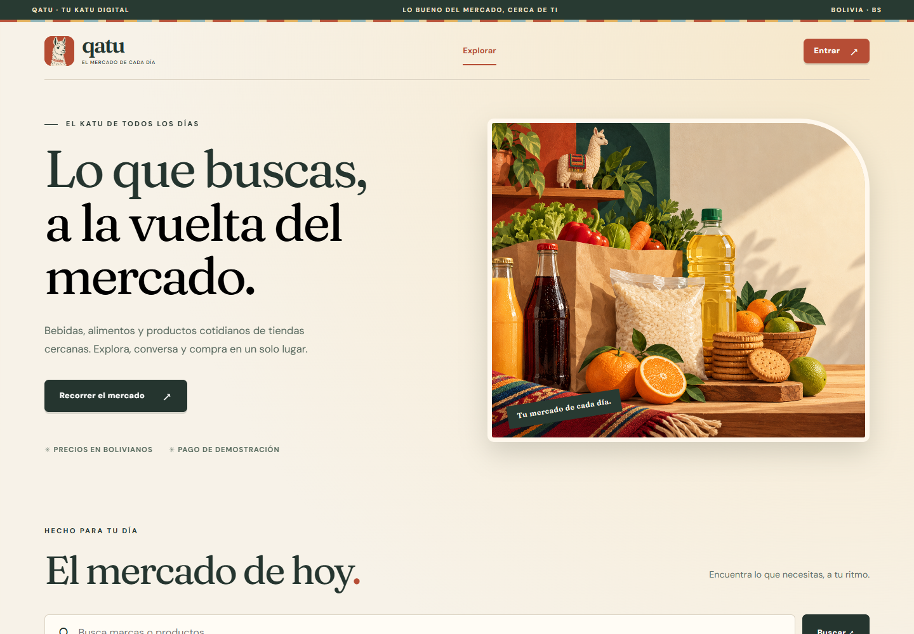
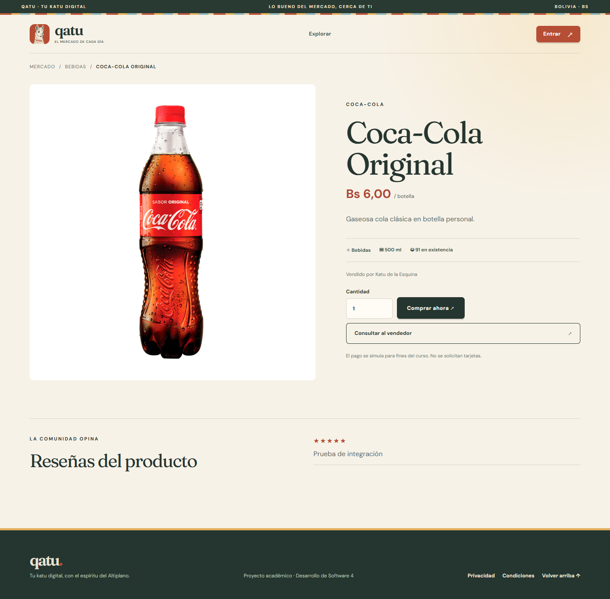
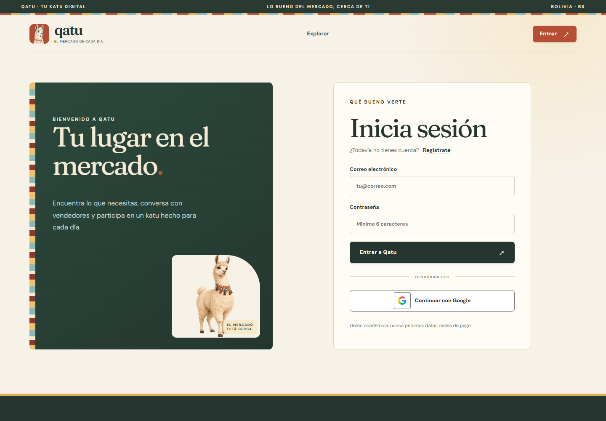

# Qatu Marketplace

Qatu is an educational marketplace inspired by Bolivia's everyday neighborhood markets. It combines a responsive single-page application, a .NET API, Supabase authentication and storage, PostgreSQL persistence, and real-time conversations through SignalR.

The demo supports buyer, seller, and administrator journeys. Payments are simulated in Bolivianos (BOB); the application never requests real card information.

## Screenshots

### Marketplace



### Product details



### Sign in



## Main features

- Product catalog with search and category filters.
- Email/password and Google authentication through Supabase.
- Buyer, seller, and administrator roles.
- Seller applications and administrator approval.
- Store and product management.
- Simulated checkout and order tracking.
- Product and seller reviews.
- Real-time buyer/seller conversations with SignalR.
- Private product-image storage.
- Responsive interface for desktop and mobile devices.

## Technology stack

- **Backend:** .NET 10, ASP.NET Core Minimal APIs, Entity Framework Core, SignalR.
- **Frontend:** Vanilla JavaScript, Vite, MVVM-style views and view models.
- **Data and identity:** Supabase Auth, PostgreSQL, and Supabase Storage.
- **Local orchestration:** Docker Compose and Nginx.
- **Testing:** xUnit and integration scripts.

## Run with Docker Compose

### Requirements

- Docker Desktop configured for Linux containers.
- A Supabase project with Auth, PostgreSQL, and Storage enabled.
- Git.

### 1. Configure the environment

Copy the safe example file:

```powershell
Copy-Item infra/hosted/.env.example infra/hosted/.env
```

On macOS or Linux:

```bash
cp infra/hosted/.env.example infra/hosted/.env
```

Fill in `infra/hosted/.env` with values from your own Supabase project:

```dotenv
QATU_SUPABASE_URL=https://YOUR_PROJECT_REF.supabase.co
QATU_PUBLISHABLE_KEY=sb_publishable_REPLACE_ME
QATU_SECRET_KEY=sb_secret_REPLACE_ME
ConnectionStrings__Qatu=Host=YOUR_POOLER_HOST;Port=5432;Database=postgres;Username=postgres.YOUR_PROJECT_REF;Password=REPLACE_ME;SSL Mode=Require
QATU_ADMIN_USER_ID=
QATU_WEB_PORT=8081
```

Never commit this `.env` file. The secret key and database password are server-only values; the browser receives only the publishable key.

### 2. Start the application

```powershell
docker compose --env-file infra/hosted/.env -f infra/hosted/compose.yml config --quiet
docker compose --env-file infra/hosted/.env -f infra/hosted/compose.yml up -d --build
docker compose --env-file infra/hosted/.env -f infra/hosted/compose.yml ps
```

Open:

- Web application: <http://localhost:8081>
- API health check: <http://localhost:8081/health>
- OpenAPI document: <http://localhost:8081/openapi/v1.json>

Database migrations run when the API starts.

### 3. Seed demo content (optional)

Python 3 is required for the helper scripts.

```powershell
python scripts/seed_demo.py accounts
docker compose --env-file infra/hosted/.env -f infra/hosted/compose.yml up -d --no-deps --force-recreate api
python scripts/seed_demo.py content
```

The script creates local demo configuration in ignored files. Do not publish generated passwords or user exports.

### 4. Stop the application

```powershell
docker compose --env-file infra/hosted/.env -f infra/hosted/compose.yml down
```

## Run without Docker

Requirements:

- .NET SDK 10.
- Node.js 24 or a compatible current release.
- A configured Supabase project and PostgreSQL connection.

Install the frontend dependencies and start Vite:

```powershell
cd web
npm ci
npm run dev
```

In another terminal, configure the API environment variables and run:

```powershell
dotnet run --project src/Qatu.Api/Qatu.Api.csproj
```

## Build and test

```powershell
dotnet build Qatu.slnx
dotnet test Qatu.slnx

cd web
npm ci
npm test
npm run build
npm run format:check
```

With the hosted stack running, the integration checks can also be executed:

```powershell
python scripts/test_live.py
pip install -r scripts/requirements-dev.txt
python scripts/test_signalr.py
```

## Project structure

```text
src/Qatu.Domain/           Domain entities and enums
src/Qatu.Application/      Use cases, contracts, and application services
src/Qatu.Infrastructure/   EF Core, repositories, migrations, and image storage
src/Qatu.Api/              REST endpoints, authentication, configuration, and SignalR
web/src/                   SPA views, view models, components, state, and styles
tests/Qatu.Tests/          Automated backend tests
infra/hosted/              API/web deployment connected to Supabase Cloud
scripts/                   Demo seed and integration-test helpers
docs/                      Architecture and project documentation
```

## Architecture

The backend follows Clean Architecture dependency rules:

- **Domain** contains entities and business enums without framework dependencies.
- **Application** exposes focused use-case contracts (`ICatalogService`, `IOrderService`, `ISellerService`, and the other feature services) and small persistence ports for reads, writes, transactions, and stock operations.
- **Infrastructure** implements those ports with Entity Framework Core and Supabase Storage.
- **API** is the composition root. Endpoints depend only on the feature contract they use, while authentication delegates profile creation and access checks to the application layer.

The frontend follows MVVM with explicit dependency injection. Pure view functions render only the state passed by their ViewModel. ViewModels coordinate UI behavior through feature services, and `createApplication.js` is the single composition root for API, authentication, state, navigation, and notifications. `ViewModelFactory` owns route-to-ViewModel creation, keeping `main.js` limited to application startup and lifecycle management.

## Security notes

- Local `.env` files, database volumes, generated demo users, test reports, and build artifacts are ignored by Git.
- Do not expose the Supabase secret key or PostgreSQL password to the frontend.
- Public registration creates buyer accounts only.
- Seller access requires administrator approval.
- Administrator identity is configured outside public registration.

## Educational scope

Qatu is an academic project for Software Development 4. The checkout flow is a demonstration and does not process real payments.
