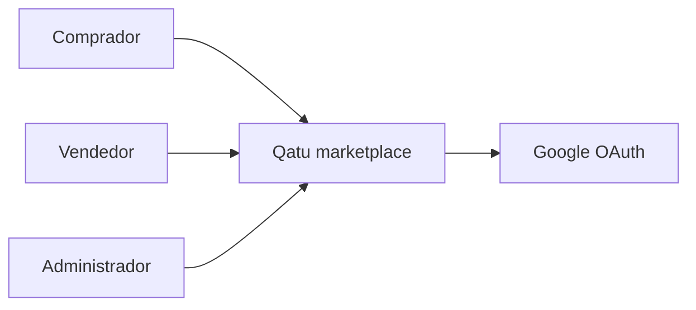
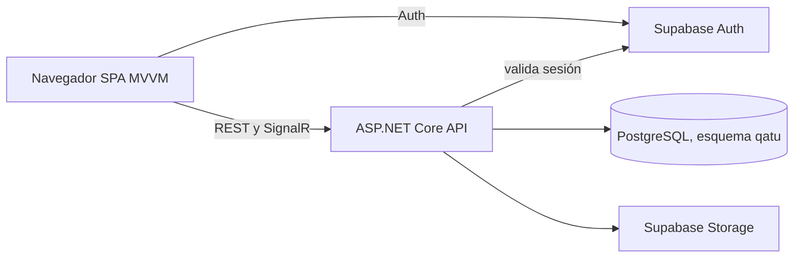
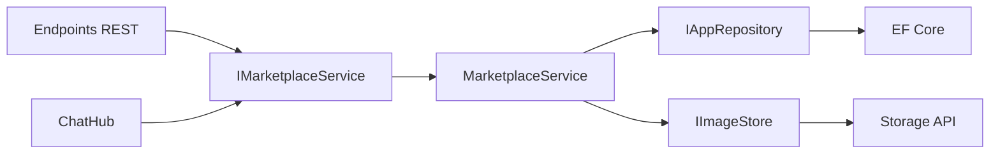
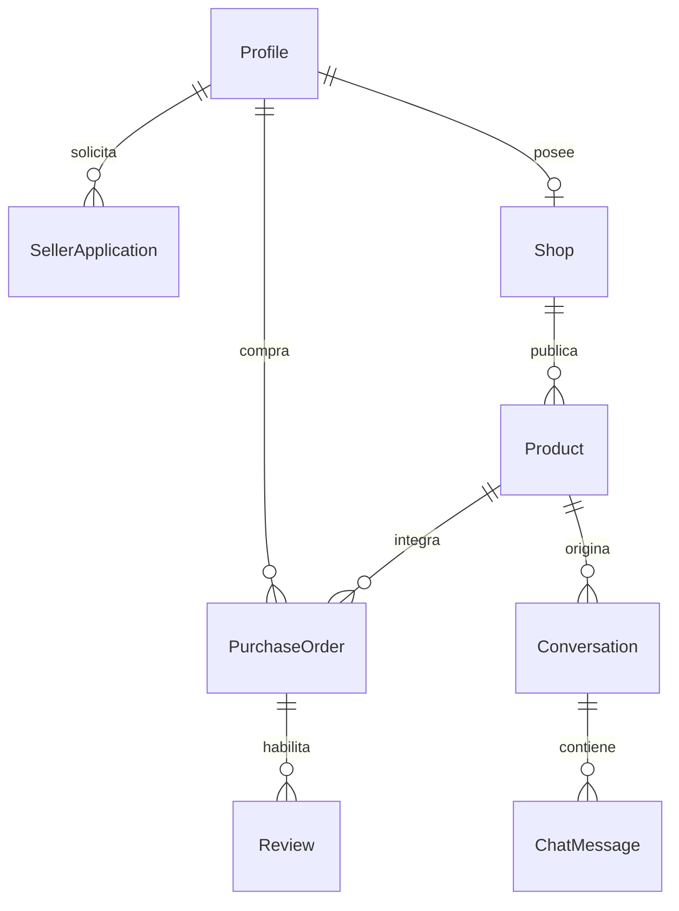
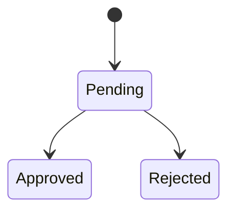
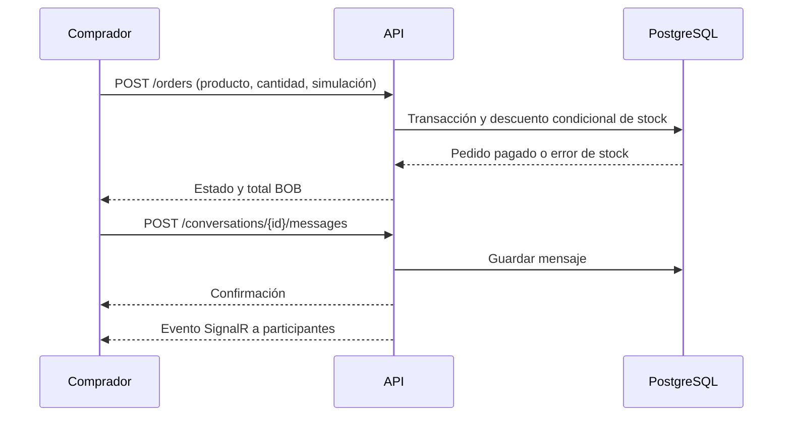

# Arquitectura

## C4: contexto

## C4: contenedores

## C4: componentes de API

## Entidades y relaciones

## Estados

Solicitud: pendiente → aprobada o rechazada. Producto: borrador → publicado ↔ oculto, con edición posterior. Pedido: se crea pendiente y en la misma transacción termina pagado o fallido. No hay estado de envío.

## Compra y conversación

Los diagramas tienen fuente editable Mermaid en este archivo. Las seis vistas exportadas están en `docs/diagrams/*.svg`; se regeneran con `python scripts/export_diagrams.py`. Auth, PostgreSQL y Storage se alojan en Supabase; SPA y API viven en Docker local. El modelo evita acceso directo del cliente al esquema de negocio. El hub valida pertenencia antes de unir a un grupo. La API valida el token con Supabase Auth y verifica rol y propiedad de cada recurso.

## Organización del código

El dominio mantiene cada entidad y enumeración en su propio archivo. La capa de aplicación declara `IMarketplaceService` y `IAppRepository`, e implementa `MarketplaceService` por capacidades mediante clases parciales (`Profiles`, `Catalog`, `Sellers`, `Products`, `Orders`, `Conversations`, `Reviews` y `Reports`). `Repositories`, `Storage`, `Models` y `Errors` contienen sus contratos y tipos individuales. Infraestructura agrupa persistencia, repositorio EF y Storage. La API registra rutas por capacidad en `Endpoints`, con `Contracts`, `Authentication` y `Hubs` separados; `Program.cs` contiene la composición, middleware y arranque. El README incluye el flujo PlantUML de Supabase Auth con Google y correo.

La SPA tiene un archivo por vista, componente y ViewModel. `main.js` conecta las rutas, mientras que `api`, `auth`, `state`, `data` y `utils` agrupan responsabilidades compartidas. Los estilos se importan por área y mantienen el orden de la cascada original: base, pantallas y ajustes de identidad/responsividad. `npm run format` y `npm run format:check` aplican y verifican el formato de JavaScript y CSS.
