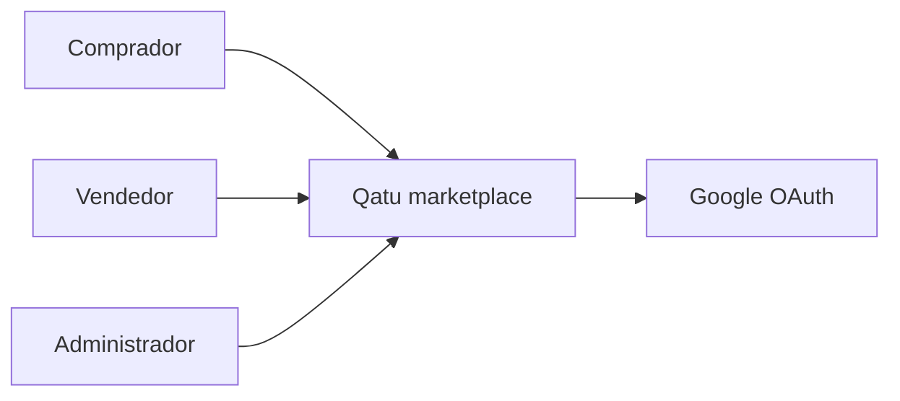
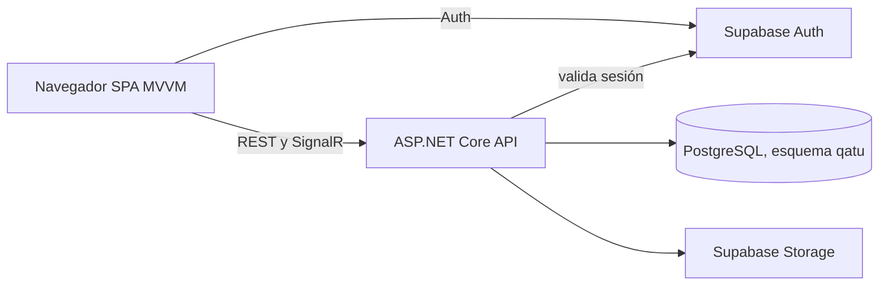
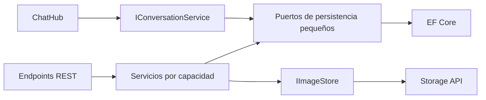
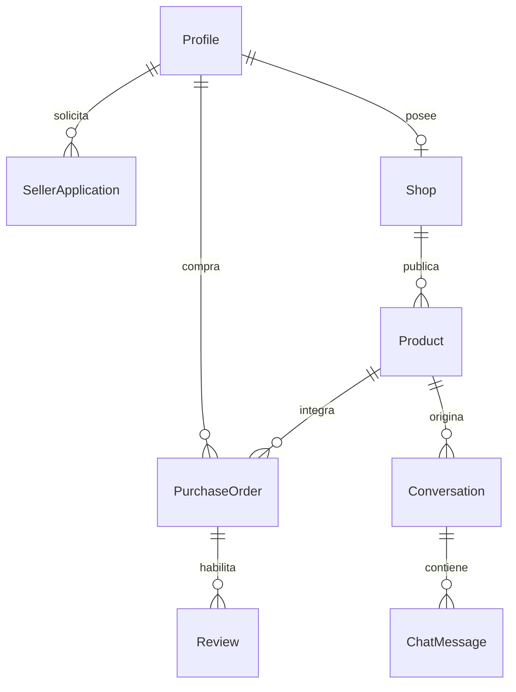
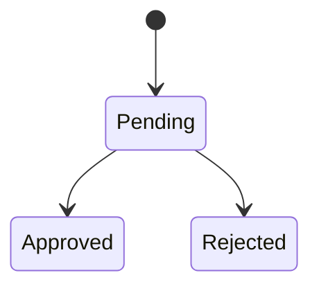
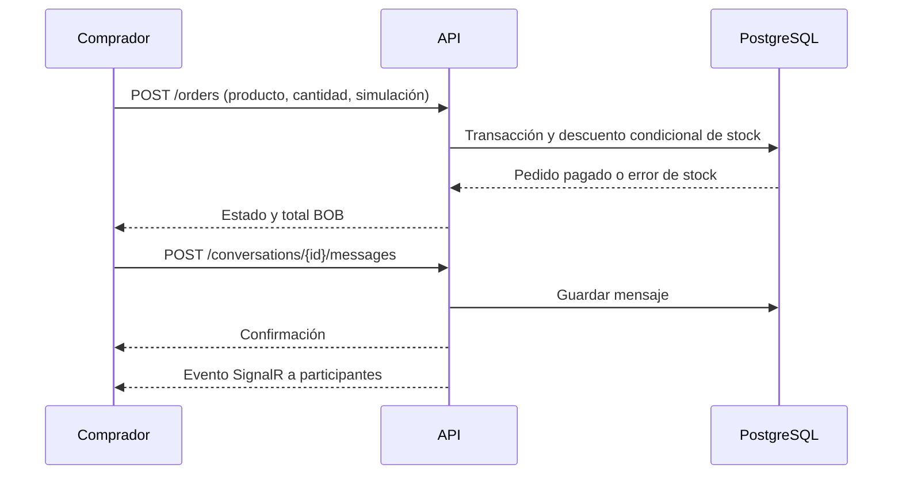

# Arquitectura

## C4: contexto

## C4: contenedores

## C4: componentes de API

## Entidades y relaciones

## Estados

Solicitud: pendiente → aprobada o rechazada. Producto: borrador → publicado ↔ oculto, con edición posterior. Pedido: se crea pendiente y en la misma transacción termina pagado o fallido. No hay estado de envío.

## Compra y conversación

Los diagramas tienen fuente editable Mermaid en este archivo. Las seis vistas exportadas están en `docs/diagrams/*.svg`; se regeneran con `python scripts/export_diagrams.py`. Auth, PostgreSQL y Storage se alojan en Supabase; SPA y API viven en Docker local. El modelo evita acceso directo del cliente al esquema de negocio. El hub valida pertenencia antes de unir a un grupo. La API valida el token con Supabase Auth y verifica rol y propiedad de cada recurso.

## Organización del código

El dominio mantiene cada entidad y enumeración en su propio archivo y no depende de frameworks. La capa de aplicación expone contratos pequeños por caso de uso: usuarios y acceso, catálogo, vendedores, productos, pedidos, conversaciones, reseñas y reportes. También aplica segregación de interfaces a la persistencia con `IReadRepository`, `IWriteRepository`, `IUnitOfWork` e `IStockRepository`. Infraestructura implementa esos puertos con EF Core y Supabase Storage. La API registra cada contrato e implementación en el punto de composición y cada endpoint recibe solo el servicio de la capacidad que utiliza.

La SPA tiene un archivo por vista, componente y ViewModel. Las vistas son funciones puras: reciben estado y no importan estado global, navegación ni acceso HTTP. Los ViewModels coordinan cada pantalla mediante servicios por capacidad. `createApplication.js` es el único punto de composición para API, autenticación, estado, navegación y notificaciones; `ViewModelFactory` resuelve rutas y crea ViewModels; `main.js` se limita al arranque y ciclo de vida. Los estilos se importan por área y mantienen el orden de la cascada original: base, pantallas y ajustes de identidad/responsividad. `npm run format` y `npm run format:check` aplican y verifican el formato de JavaScript y CSS.
