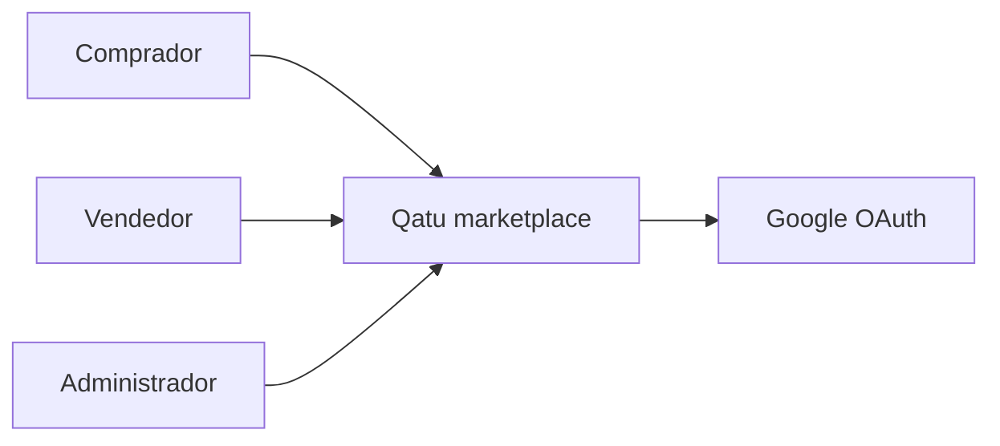
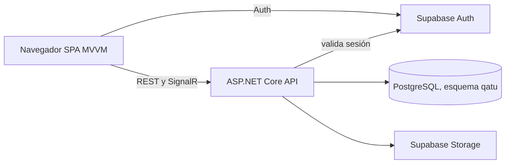
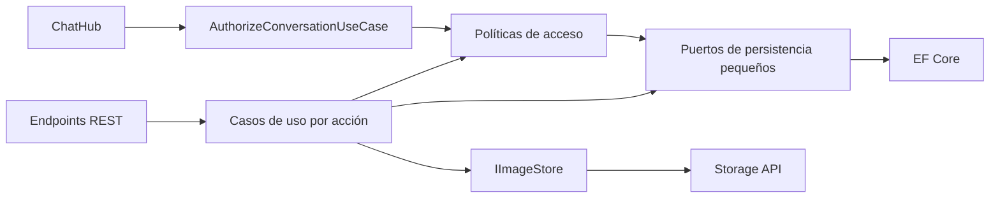
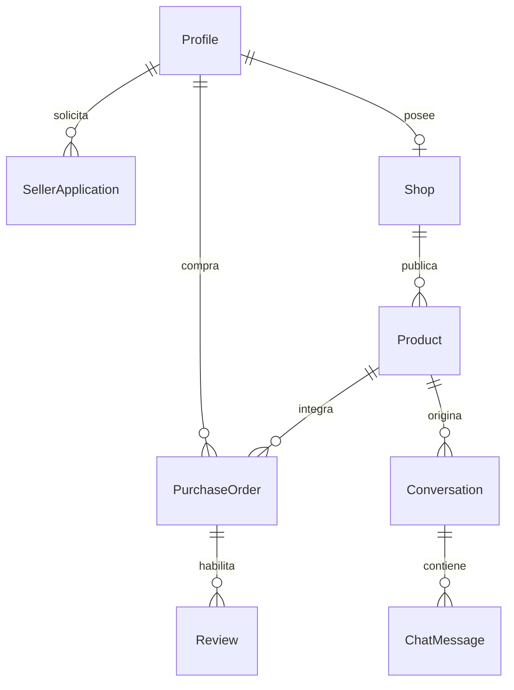
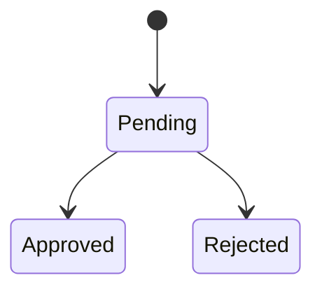
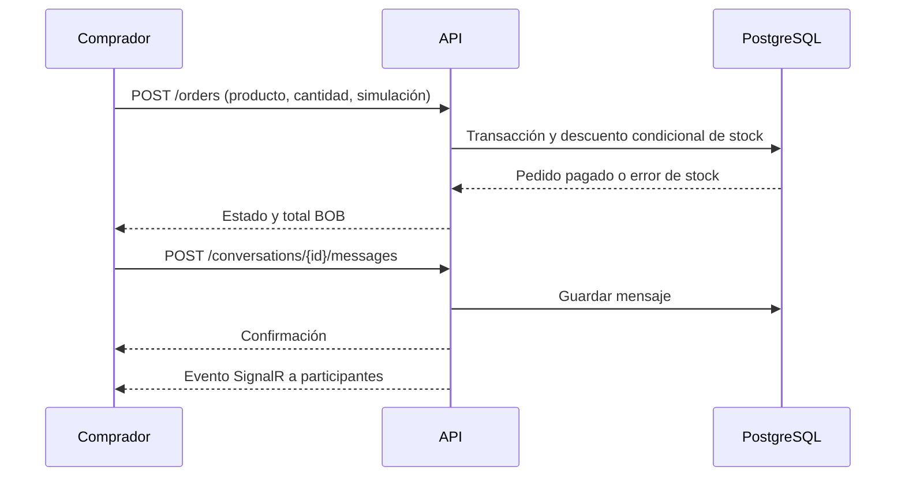

# Arquitectura

## C4: contexto

## C4: contenedores

## C4: componentes de API

## Entidades y relaciones

## Estados

Solicitud: pendiente → aprobada o rechazada. Producto: borrador → publicado ↔ oculto, con edición posterior. Pedido: se crea pendiente y en la misma transacción termina pagado o fallido. No hay estado de envío.

## Compra y conversación

Los diagramas tienen fuente editable Mermaid en este archivo. Las seis vistas exportadas están en `docs/diagrams/*.svg`; se regeneran con `python scripts/export_diagrams.py`. Auth, PostgreSQL y Storage se alojan en Supabase; SPA y API viven en Docker local. El modelo evita acceso directo del cliente al esquema de negocio. El hub valida pertenencia antes de unir a un grupo. La API valida el token con Supabase Auth y verifica rol y propiedad de cada recurso.

## Organización del código

El dominio mantiene cada entidad y enumeración en su propio archivo y no depende de frameworks. La capa de aplicación organiza comandos, consultas y casos de uso explícitos por funcionalidad: usuarios, catálogo, vendedores, productos, pedidos, conversaciones, reseñas y reportes. Cada comando, consulta, modelo, regla y caso de uso tiene su propio archivo; `ProductData`, `ProductRules` y `CreateProductUseCase`, por ejemplo, ya no comparten una unidad de código. Las reglas de acceso compartidas viven en políticas pequeñas. La persistencia mantiene interfaces segregadas con `IReadRepository`, `IWriteRepository`, `IUnitOfWork` e `IStockRepository`. Infraestructura implementa esos puertos con EF Core y Supabase Storage. La API separa contratos, mapeadores, serialización, manejo de errores y registro de dependencias; cada endpoint recibe únicamente el caso de uso que ejecuta.

La SPA tiene una operación de aplicación por archivo dentro de `usecases`; ya no existen servicios de funcionalidades que agrupen acciones no relacionadas. Las vistas son funciones puras y delegan secciones complejas a componentes pequeños por pantalla. Los ViewModels coordinan estado y presentación, mientras los controladores de UI encapsulan enlaces DOM complejos como la administración de productos del vendedor. `createApplication.js` y `createUseCases.js` componen dependencias; `ViewModelFactory` resuelve rutas y crea ViewModels; `main.js` se limita al arranque y ciclo de vida. Los estilos se importan por área y mantienen el orden de la cascada original: base, pantallas y ajustes de identidad/responsividad. `npm run format` y `npm run format:check` aplican y verifican el formato de JavaScript y CSS.
